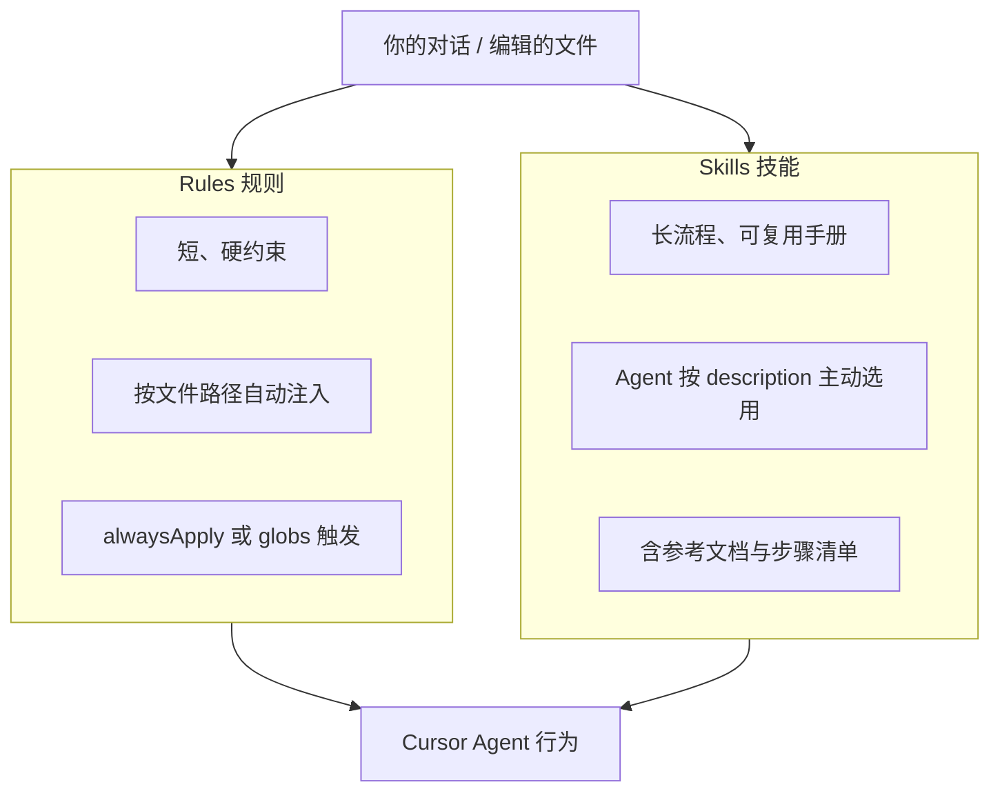
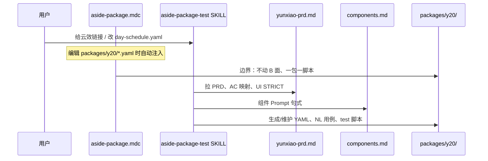

# `.cursor` 下 rules 与 skills 解读

本文说明本仓库 [`.cursor/rules/`](rules/) 与 [`.cursor/skills/`](skills/) 在 Cursor Agent 中的分工、触发方式及现有文件作用。

---

## 一、Cursor 里两者分别是什么



| 维度 | **Rules**（`.cursor/rules/`） | **Skills**（`.cursor/skills/`） |
|------|------|--------|
| 定位 | 项目级「红线 + 约定」，像编码规范 | 任务级「怎么做」操作手册，像 SOP |
| 体量 | 通常一页以内（`.mdc`） | 主文件 + 多篇 reference（`.md`） |
| 触发 | `globs` 匹配当前打开/编辑的文件时注入；或 `alwaysApply: true` 全局生效 | Agent 根据 `description` 关键词判断「该不该读这份 skill」 |
| 内容侧重 | **边界、禁止项、命名、目录结构** | **完整工作流、映射表、检查清单、示例** |
| 典型用法 | 「改 A 面 YAML 时不要动 B 面」 | 「从云效 PRD 拉需求 → 生成 NL 用例 → YAML → 注册 packages」 |

**关系**：Rules 告诉 Agent「什么不能做、文件放哪」；Skills 告诉 Agent「接到某类任务时按什么步骤做、查哪张表」。

---

**本项目 `.cursor/rules` 有什么**

当前规则文件：

### [`prd-case-and-fix.mdc`](rules/prd-case-and-fix.mdc)（`alwaysApply: true`）

**作用**：A/B 面通用硬约束。

1. **严格按 PRD TC/AC** 设计用例与生成脚本，禁止擅自跳过核心路径；无法自动化的须在 NL 标明原因。
2. **非 token 额度类失败**：先读失败截图识别真实 UI → 修 locate/assert/flow → 再继续；额度耗尽则停跑并提示用户，不改用例「绕过」。

### [`aside-package.mdc`](rules/aside-package.mdc)

**作用**：在编辑 A 面相关文件时，自动把 A/B 面边界和硬约定注入 Agent 上下文。

**触发范围**（`globs`）：

- `packages/**/*.yaml`、`packages/**/*.md`
- `tests/aside/**/*.ts`
- `config/packages.yaml`
- `core/aside-runner.ts`、`core/package-profile.ts`
- `templates/aside-nl-case*.txt`

**核心约束**：

- **A 面** = `packages/{id}/` + `tests/aside/`；**B 面** = `data/*.yaml` / `business-*` — **禁止为 A 面改 B 面**
- 云效 PRD 链接 → 用 `user-yunxiao` MCP 拉 work item
- **一包一脚本**：`packages.yaml` + pages YAML + NL 用例 + `test:aside:{id}`
- Prompt 硬规则：`locatePrompt` + Do NOT tap、PRD 精确英文字符串、UI STRICT verify、Delete/Cancel 策略
- 与全局 `prd-case-and-fix.mdc` 互补（PRD 全量覆盖 + 识图修错）

**`alwaysApply: false`**：只有碰到上述路径的文件时才生效，不会污染无关对话（如改无关文档）。

---

## 三、本项目 `.cursor/skills` 有什么

当前 1 个技能包目录：**`aside-package-test/`**

### 主入口 [`aside-package-test/SKILL.md`](skills/aside-package-test/SKILL.md)

**何时会被 Agent 读取**（`description` 触发词）：

- 新建/维护 A 面测试、Y20/T42 包、云效 PRD、`packages/*/pages` YAML、`tests/aside/*.test.ts` 等

**提供的内容**：

- A/B 面边界表、引擎入口 `runAsidePackage`
- 自然语言 → YAML `flow` 映射表（verify / tap-text / fill-input / force-stop 等）
- 新建包 6 步清单、T42/Y20 参考命令
- 指向两篇 reference 文档

### 参考文档 1：[`yunxiao-prd.md`](skills/aside-package-test/yunxiao-prd.md)

**作用**：云效 PRD → A 面自动化的**标准 SOP**（比 rule 更细、更长）。

包含：

- MCP 调用顺序（`get_current_organization_info` → `get_work_item`）
- URL 解析 workItemId
- PRD → 产物路径表（NL 用例、YAML、packages 注册、test script）
- AC/TC → flow 映射（AC-010 空 Save、AC-012 100 字、AC-016 relaunch 等）
- UI STRICT 校验模板（颜色、dp、圆角、Fail 条件）
- 交付检查清单

**与根目录 PRD 文档的关系**：[`Y20面包开发-云效PRD-0e040308d09761451e8d96019c.md`](../Y20面包开发-云效PRD-0e040308d09761451e8d96019c.md) 是**需求原文快照**；`yunxiao-prd.md` 是**如何把原文变成自动化**的方法论。

### 参考文档 2：[`components.md`](skills/aside-package-test/components.md)

**作用**：A 面 UI 组件字典 — 写 `locatePrompt` / `assertPrompt` 时的句式模板。

覆盖：额度卡、底部 Tab、Profile 行、删除确认框、表单输入、Y20 日历/FAB/Bottom Sheet 等。

---

## 四、协作方式（以 Y20 为例）



1. 打开或修改 `packages/y20/pages/day-schedule.yaml` → **rule** 提醒 A 面约定。
2. 说「按云效 PRD 加 AC-016」→ **skill** 引导读 `yunxiao-prd.md`，走 MCP + 映射表。
3. 写 FAB / Save / 删除弹窗的 prompt → **skill** 指向 `components.md` 套句式。

---

## 五、和 Cursor 全局 skills 的区别

Cursor 还会加载用户/插件自带的 skills（如 `create-rule`、`create-skill`、Figma 插件 skills），路径通常在 `C:\Users\Win\.cursor\skills-cursor\` 或插件缓存下。

**本项目 `.cursor/skills/`** 是**仓库专属**技能，随 git 共享给团队 — 只描述 **midscenetool 的 A 面测试** 怎么做。

---

## 六、何时改 rule、何时改 skill

| 想改什么 | 改哪里 |
|----------|--------|
| 新增「禁止修改某目录」、调整 globs 触发范围 | `.cursor/rules/*.mdc` |
| 补充 Prompt 硬规则（一行级约束） | `.cursor/rules/*.mdc` |
| 新增完整工作流（如云效 → YAML 新步骤） | `.cursor/skills/.../SKILL.md` 或 `yunxiao-prd.md` |
| 新增 UI 组件句式 | `components.md` |
| 新包类型的参考命令、映射表 | `SKILL.md` |

**原则**：短约束进 rule；长流程、表格、检查清单进 skill。

---

## 七、当前目录一览

```
.cursor/
├── README.md                  # 本文件：rules/skills 解读
├── rules/
│   ├── prd-case-and-fix.mdc # A/B 面：严格按 PRD + 非额度失败先识图修复（alwaysApply）
│   └── aside-package.mdc      # A 面扩展约定（globs 触发）
└── skills/
    └── aside-package-test/
        ├── SKILL.md           # 技能主入口 + 映射表
        ├── yunxiao-prd.md     # 云效 PRD → 自动化 SOP
        └── components.md      # 组件 Prompt 字典
```

B 面 H5（`data/*.yaml`）受全局 `prd-case-and-fix.mdc` 约束；A 面另有 `aside-package.mdc` + skill `aside-package-test`。
